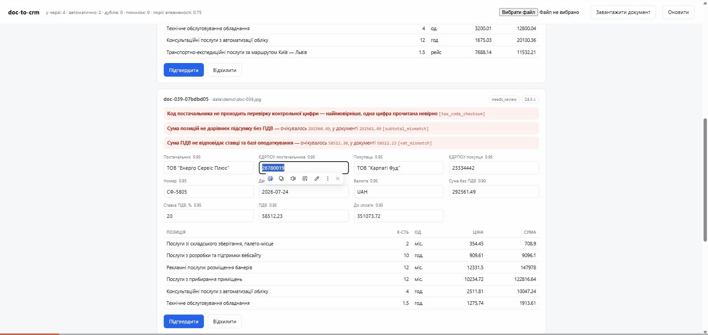

**English** | [Українська](README.uk.md)

# doc-to-crm

A processor for primary accounting documents: a PDF or a photo of an invoice goes in, a
structured ledger entry comes out. Doubtful documents do not pass silently; they go to a manual
review queue **with an explanation of what exactly did not match**.

The project's main point in one sentence:

> **The model hallucinates amounts, so amounts are checked by Python, not by the model.**

A language model sees "12 400,00" and "12 480,00" as two similar strings. An eighty-hryvnia
difference is not an arithmetic error for it: it does not calculate at all. So everything that
can be recomputed or checked with a check digit is recomputed by code: line amounts, VAT, the
total, the EDRPOU (Ukrainian company code) check digit, the date. The model is responsible for
one thing only: **reading what is printed**.



The recording is a real run, not a mock-up: a hard photo of an invoice on which the model read
one digit of the EDRPOU wrong. The code failed the check digit, the amounts did not add up, the
document went to the queue with three explanations; after a correction and confirmation it goes
to the ledger with the fixed numbers.

The second point was: **confidence per field, not per document**, to highlight for the reviewer
exactly the fields the model read uncertainly. It is implemented, and measurement showed that it
**does not work**: the model gives itself 1.00 practically always, including where it is wrong.
That is no reason to hide it; on the contrary, it is the most interesting result of the project,
and it is below with numbers.

---

## The headline number

On 40 documents (`gemini-3.5-flash-lite`, full report in [`output/eval-report.md`](output/eval-report.md)):

> **The model's confidence caught 0 of 9 problem documents. Arithmetic in Python caught 8 of 9.**

The model gave itself 1.00 on every field in **36 documents of 40**; the lowest value in the whole
set is 0.85, meaning **no field ever dropped below the 0.75 threshold**. Including the documents
where it read `9489.98` as `9490.98`. The model's self-report of its own confidence is not a
signal here, and this is exactly the case where a nice-looking mechanism ("confidence per field")
had to be measured rather than declared.

The rest of the numbers are in [Metrics](#metrics).

---

## Quick start

```bash
python -m venv .venv
.venv/Scripts/pip install -r requirements.txt     # Linux/macOS: .venv/bin/pip

cp .env.example .env
# in .env: GEMINI_API_KEY=<key from https://aistudio.google.com/apikey>

.venv/Scripts/python main.py gen-dataset          # 40 synthetic documents + golden data
.venv/Scripts/python main.py process data/synthetic --report output/run.json
.venv/Scripts/python main.py serve                # review UI at http://localhost:7860
```

Without a key the service **still starts**: the queue, the review UI and a person's decisions
work, `/health` shows `extraction_enabled: false`, and `POST /documents` returns 503. That is
deliberate: showing an empty form instead of extraction would mean a demo that looks working
and is not.

### Commands

| Command | What it does |
|---|---|
| `gen-dataset` | Generates synthetic invoices + golden data `data/golden.jsonl` |
| `process <path>` | Processes a file or a folder, writes to SQLite and the ledger |
| `watch [folder]` | Watches a folder and processes new files |
| `serve` | HTTP API + review UI on `PORT` (default 7860) |
| `eval` | Per-field accuracy and routing quality against the golden data |

Useful options:

```bash
main.py process data/synthetic --concurrency 2 --limit 5
main.py process data/synthetic --min-confidence 0.9   # a stricter threshold
main.py process data/synthetic --no-validation        # turn off the validation layer
main.py eval --from-ledger output/eval-run.json       # metrics without model calls
main.py watch data/inbox --interval 3 --max-cycles 20
```

### Environment variables

| Variable | Default | Why |
|---|---|---|
| `GEMINI_API_KEY` | — | Required for extraction |
| `DOC_MODEL` | `gemini-3.5-flash-lite` | Model |
| `MIN_FIELD_CONFIDENCE` | `0.75` | Threshold below which a field is highlighted and the document goes to a person |
| `DOC_RPM` | `5` | Requests per minute limit (free tier quota) |
| `PORT` | `7860` | Service port; the one HF Spaces expects |

### Tests

```bash
.venv/Scripts/python -m pytest -q          # a regular run
.\scripts\run_tests_capped.ps1             # with a memory limit (Windows + Docker)
```

**111 tests, not a single network call.** No key needed: the LLM is replaced by a fake client
that implements the same `VisionClient` protocol.

`run_tests_capped.ps1` runs the suite in a container with `--memory 1g`, so the kernel holds the
limit through cgroups. This is not paranoia: an unclosed loop in the tests once ate 27 GB and took
down the editor. The previous version set the same ceiling through a Windows Job Object and
P/Invoke into `kernel32`, and Avast quarantined it as `IDP.HELU.PSD11` (a "process manipulation"
heuristic, a false positive). Checked that the ceiling really holds: trying to allocate 3 GB under
a 512 MB limit exits with code 137; the kernel kills the process, the host is fine.

### Docker

```bash
docker build -t doc-to-crm .
docker run --rm -p 7860:7860 --env-file .env doc-to-crm
```

The image is **83 MB**; not only the build was checked but the full path inside the container:
`POST /documents` with a real invoice → `auto_ok` in 2.14 s, and the healthcheck turns `healthy`.
The port is read from `$PORT`, not hard-coded: otherwise the healthcheck would silently check the
wrong service as soon as the port was changed through the environment. The key is passed with
`--env-file`; it is never in the repository.

---

## Data schema

`InvoiceExtraction` (`src/schema.py`) is the single source of truth: the same model goes to Gemini
as `response_schema` and validates the raw response.

```
doc_type, supplier_name, supplier_edrpou, buyer_name, buyer_edrpou,
invoice_number, invoice_date, currency,
line_items[{description, quantity, unit, unit_price, amount}],
subtotal, vat_rate, vat_amount, total,
confidence{for each field separately, 0.0-1.0}
```

Two decisions worth explaining:

**The date arrives as a string, not as a `date` type.** If the model returns "31.02.2026", Pydantic
with a `date` type would drop the whole document into a `ValidationError`, and the reason would
stay invisible. Python parses the date and produces a clear mismatch (`date_unparseable`, with
what exactly was read) instead of an exception.

**Confidence is a model with explicit fields, not `dict[str, float]`.** A dictionary with arbitrary
keys becomes `additionalProperties` in Gemini's JSON schema, and the model starts inventing keys
that are not in the document. An explicit list makes the schema closed; a test catches the list
drifting out of sync with the code.

---

## Three things that make this different from "chat with a PDF"

### 1. A validation layer outside the LLM

`src/validate.py` knows nothing about the model and so is fully covered by tests without network.
What is checked:

| Check | Example mismatch |
|---|---|
| `line_amount_mismatch` | quantity × price ≠ line amount |
| `subtotal_mismatch` | sum of lines ≠ subtotal before VAT |
| `vat_mismatch` | VAT does not match the rate and the base |
| `total_mismatch` | subtotal + VAT ≠ amount due |
| `tax_code_checksum` | the EDRPOU fails the check digit |
| `date_in_future` | the document is dated tomorrow |
| `duplicate_invoice_number` | this number from this supplier already exists |

Every mismatch carries `expected` and `actual`: the reviewer sees not "the amount did not match"
but "should be 12 000.00, the document says 12 000.50".

**The EDRPOU check digit** is a story of its own. The weights depend on the code range (for
30 000 000-60 000 000 they are shifted), and if the remainder equals 10, the calculation is
repeated with weights increased by 2. The algorithm was checked against public codes of real
companies; a test separately checks that **any single misread digit is caught**, exactly the
mistake OCR makes on a crumpled corner.

The tolerance when reconciling amounts grows with the number of lines: each line is rounded
separately, so on 20 lines a legitimate difference is up to 20 kopecks too. Without this the
validation layer would pour false alarms over normal documents.

### 2. Idempotency at two levels

| Level | Key | Behaviour |
|---|---|---|
| Exact | SHA-256 of the content | The same file under another name does not pass twice; **the model is not called at all** |
| Soft | document number + supplier EDRPOU | A rescan of the same invoice: different bytes, same document → to a person's queue |

A soft duplicate is deliberately **not** blocked silently: it can also be a legitimate correction,
and a person should decide. An exact one is blocked, and that is where a model call is saved: the
watcher rereads the folder every three seconds and without this check would pay for every round.

The check happens **before** the model call; the `test_duplicate_costs_no_model_call` test watches
exactly that.

### 3. One routing, two independent signals

A document reaches a person for two different reasons; that was the design:

- **validation** catches what the model read confidently and wrongly, the classic case: a neatly
  printed amount that does not add up with the lines;
- **confidence** was supposed to catch what the model itself could not read: a crumpled corner, a
  cropped scan; no error yet, but no trust either.

The hypothesis was that each is leaky without the other. Measurement did not confirm it: the
second signal did not fire once on this set (see [Metrics](#metrics)). The mechanism stayed in the
code (it costs zero extra calls, and on documents where a field is really unreadable it will
behave differently), but **the first signal carries the quality**, and the README should not
dress that up.

For exactly this check, three routing configurations (validation + confidence / confidence only /
validation only) are computed **from one run**: the recomputation goes over the saved extractions,
so the comparison table costs one run, not three.

The consequence for the ledger: **only `auto_ok` gets into the ledger**, i.e. what passed the
checks or was confirmed by a person. A document waiting for a decision does not exist in the
ledger yet; it lives in the SQLite queue. The temptation to write `needs_review` there too ("so
nothing gets lost") turns into quiet data loss: the row would land with unconfirmed numbers, and
after the reviewer's correction deduplication by hash would no longer let the fixed version in.
There is a separate regression test for this.

---

## Four levels of resilience

The levels are separated because these are different classes of problem, and mixing them up is
expensive.

| Level | Reacts to | What it does |
|---|---|---|
| Rate limiter | the free tier quota | spreads calls over time so as not to run into 429 |
| Backoff | per-minute 429, 5xx, network drop | a pause and a retry; listens to the server's `retryDelay` |
| Circuit breaker | the **daily** quota | fails immediately, no pointless calls |
| Self-repair | invalid JSON / Pydantic | shows the model its own error |

Plus something that is not a resilience level but an invariant: **no input file is lost**. A
failure after all retries is a record with status `fallback_error` and the technical reason, not
silence in the logs. Aggregates are computed over successful ones only.

`MemoryError` and `RecursionError` are deliberately **not** wrapped into a fallback: they are a
state of the process, not an error of the document. If they are swallowed, the loop carries on and
finishes off the machine; that is exactly how one of my earlier projects took down the editor.

---

## Dataset

There are no real third-party documents in the repository, only generated ones. But the generator
is built so that the dataset is honest:

- **The layout is described once**, as a list of primitives, and rendered by two backends:
  reportlab → PDF with a text layer, Pillow → raster. If the layout were written separately for
  each, the PDF and the photo would slowly drift apart, and a difference in metrics would mean a
  difference in layouts, not in input quality.
- **"Photos" are degraded in the order of physics**: cropping → rotation → perspective → uneven
  lighting → defocus and sensor noise → JPEG. Compressing earlier would smear the artefacts with
  the following steps.
- **Two levels of photo difficulty, and the second did not appear for looks.** On the first version
  of the set the model scored 100% on every field; such an eval tells nothing apart: it shows
  neither the limits of applicability nor the use of thresholds. The `hard` level is what really
  reaches an accounting department: shot from a distance in passing, in bad light, and recompressed
  by a messenger on top. The boundary had to be calibrated: the first attempt was too aggressive and
  pushed the outer column out of frame, the very one with the amounts. The result was not a hard
  scan but a ruined document that could no longer be checked against the golden data, because a
  person could not read it either. So a margin is added around the sheet before the perspective
  transform.
- **EDRPOU codes are completed with a valid check digit**; otherwise the validation layer would
  light up with errors on its own dataset and measure nothing.
- **Amounts in words** give a second, independent source of truth about the total: a model that
  "painted in" a digit almost always contradicts the words.
- **The golden data is written by the same code that draws the document**, so the labels cannot
  drift from the picture.

Separately, the set has 5 documents with a **deliberate mismatch** (the total does not add up, VAT
from an old base, a date in the future, a broken check digit). The document is spoiled, not the
golden data: a model that correctly read the printed numbers counts as having worked correctly,
and catching the mismatch is the validation layer's job. That is what happens regularly with real
documents.

---

## Metrics

One run, 40 documents, `python main.py eval`. The raw run is saved in
[`output/eval-run.json`](output/eval-run.json), so every table below is reproduced without a single
model call: `main.py eval --from-ledger output/eval-run.json`.

**Fully correct documents: 90.0%** (36 of 40).

### Per-field accuracy

| Field | Accuracy | Field | Accuracy |
|---|---|---|---|
| `supplier_name` | 95.0% | `subtotal` | 95.0% |
| `supplier_edrpou` | 97.5% | `vat_rate` | 100.0% |
| `buyer_name` | 100.0% | `vat_amount` | 97.5% |
| `buyer_edrpou` | 100.0% | `total` | 95.0% |
| `invoice_number` | 100.0% | `line_items` | 95.0% |
| `invoice_date` | 100.0% | `currency` | 100.0% |

### Routing: what each layer catches

Three configurations, computed from one run.

| Configuration | Caught | Missed | False alarms | Recall | Precision | Automatic |
|---|---|---|---|---|---|---|
| validation + confidence | 8 | 1 | 0 | **88.9%** | 100.0% | 80.0% |
| confidence only | 0 | 9 | 0 | **0.0%** | — | 100.0% |
| validation only | 8 | 1 | 0 | **88.9%** | 100.0% | 80.0% |

The second and third rows are the project's conclusion. The Python checks do all the work; the
model's confidence adds **nothing**: rows 1 and 3 match document for document.

`recall` matters more than `precision` here on purpose: a missed error reaches the ledger silently,
while an extra document in the queue costs 45 seconds of attention. There were no false alarms at
all, by the way: the tolerance for kopeck-level differences that grows with the number of lines
proved itself.

### Where exactly it breaks: PDF vs photo

| Input | Documents | Fully correct | `total` accuracy | Routing recall |
|---|---|---|---|---|
| PDF with a text layer | 22 | **100.0%** | 100.0% | 100.0% |
| photo, normal | 8 | **100.0%** | 100.0% | 100.0% |
| photo, hard | 10 | **60.0%** | 80.0% | 75.0% |

**All four extraction errors are on hard photos.** And all are the same in nature: one digit read
wrong where the print is small and blurred.

| Document | What was read | Caught by the validator? |
|---|---|---|
| doc-008 | VAT `9489.98` → `9490.98` | yes: `vat_mismatch`, `total_mismatch` |
| doc-039 | EDRPOU `26789019` → `26780019`, line amount `147978.6` → `147978.0` | yes: `tax_code_checksum`, `line_amount_mismatch` |
| doc-040 | line amounts `3642.6` → `3642.0`, `41580.96` → `41580.0` | yes: `subtotal_mismatch` |
| doc-033 | `ТОВ «Агросвіт-Плюс»` → `ТОВ «Агро світ-Плюс»` | **no** |

The last row is the only missed error in the whole set, and it shows the limit of the approach more
honestly than any of the caught ones: **arithmetic protects numbers, nothing protects a name.** An
extra space in a counterparty's name has nothing to be checked against, and the model was 0.95 sure
of it. The right answer is a counterparty directory and matching by EDRPOU, not a higher confidence
threshold.

The comparison with the golden data is strict, too: in doc-040 the model also wrote
`ФОП Кравченко I. М.` with a Latin `I` instead of a Cyrillic `І`; that counted as a mismatch,
although for a person the name is the same.

### Planted mismatches

**5 of 5.** Every document with deliberately spoiled arithmetic, a date in the future or a broken
check digit went to review with exactly the mismatch code that was planted.

### Time and cost

| | |
|---|---|
| Model latency | mean **2.77 s**, p50 2.6 s, p95 4.65 s |
| Time in the pipeline including waiting for the 5 requests/min quota | mean 23.3 s, p50 24.1 s |
| Tokens per document | 1347 input, 591 output |
| **Cost per 1000 documents** | **$0.37** |
| Person-hours per 1000 documents | by hand 50.0 → with the system **2.5** |

Two different latency numbers, on purpose. The model answers in 2.8 s; the 23 seconds are our own
throttling for the free tier, and passing that off as the model's speed would be a substitution.

The ROI is computed conservatively: 180 s per document by hand (the lower bound from the task
description) against 45 s to review one document in the queue, with a 20% share of manual review.

---

## Where it breaks / limits

- **One page.** The pipeline gives the model the whole file, but the golden data and the schema
  assume a one-page document. A multi-page act with a table over three sheets will now give lines
  only from the page the model considers the main one. The right way is to split into pages and
  stitch the lines together.
- **The model's confidence is not calibrated, and that is measured, not assumed.** 36 of 40
  documents got 1.00 on every field, the lowest value in the set is 0.85, no field ever dropped below
  the 0.75 threshold. The threshold is not "something to tweak": there is nowhere to move it,
  because there is no distribution. A working option is to take uncertainty not from the model's
  words but from its behaviour: two runs with `temperature > 0` and comparing the answers, or
  logprobs if the provider returns them.
- **Counterparty names have nothing to be checked against.** The only missed error in the whole set
  is an extra space in a supplier's name. Arithmetic protects numbers, the calendar protects dates,
  the check digit protects codes, and nothing protects a name. A threshold does not cure that; a
  counterparty directory does.
- **The dataset is synthetic, and I set its difficulty myself.** The first version was too easy,
  100% on every field; after harder degradation a real 60% on hard photos appeared. But it is still
  a render, not real paper: no folds, no hand shadows, no stamps over the text, no upside-down
  pages. Read the numbers as an upper bound.
- **A daily quota is not a per-minute quota.** Gemini returns `retryDelay` in *every* 429, even when
  the daily quota is exhausted. Obeying that advice blindly means hours of hopeless retries.
  Recognised by `quotaId` (`PerDay`) → a circuit breaker stops the run. **Not closed**: unfinished
  documents are not caught up automatically; that has to be started by hand.
- **No resume for an interrupted run.** SQLite keeps state, so a repeated run does not double what
  was processed, but there is no separate command to pick "only what is left" yet; it is a missing
  flag.
- **The sink is local only.** The `Sink` interface is designed for an external ledger (the "is the
  record already there" check sits in it precisely because neither Sheets nor Odoo has a UNIQUE
  index on our hash), but there is only one implementation now, JSONL. An Odoo adapter over
  JSON-RPC is the next step once there is an instance.
- **Currency is not converted.** An invoice in USD lands in the ledger in USD. Real accounting needs
  the exchange rate on the document date, which is a separate data source.
- **`--no-validation` exists only for eval.** It is a switch for one row of the comparison table, not
  an operating mode.
- **The review UI does not show the document itself.** The reviewer sees fields, mismatches and
  confidence, but to compare with the original the file has to be opened separately. A page preview
  next to the fields is the most obvious thing missing.
- **TLS inspection, and how I still tripped over it.** On networks with a corporate proxy `certifi`
  lacks the local root and every call fails with `CERTIFICATE_VERIFY_FAILED`. Closed with
  `truststore` (trust comes from the OS store); certificate verification was **not** turned off,
  that would be the same as working without TLS. The trap was not in the fix itself but in it being
  called in each command separately, and exactly one, `eval`, was left without it. `process` on the
  same file worked, while `eval` put all 40 documents into `fallback_error`. Now there is one call,
  in `main()`, before parsing arguments. Tests without network cannot catch this class of error in
  principle.
- **On the free tier "latency" is easy to pass off as model speed.** The first version measured a
  document's time through the whole pipeline, which includes waiting for the 5 requests/min quota.
  That gave p50 ≈ 24 s, although the call itself takes seconds. Now the stopwatch starts after the
  rate limiter, and the report has two different numbers: model time and queue time.

---

## What I would do next

Ordered by what would give the most on the measured numbers, not by what is more fun to write.

1. **A counterparty directory and matching by EDRPOU.** Closes the only missed error of the set: the
   code passes the check digit, but the name does not match the directory, so the document goes to
   review. It also normalises names, which removes the Latin `I` in "Кравченко І. М." too.
2. **Uncertainty from behaviour, not from the model's words.** The self-report is measured and does
   not work. A cheap substitute: a second run with `temperature > 0` for documents that passed
   automatically, with disagreement between the answers as the signal. A more expensive one:
   logprobs, if the provider returns them.
3. **A document preview in the review UI** next to the fields: the cheapest improvement for the
   person who has already opened the queue anyway.
4. **Odoo over JSON-RPC** as a second sink: `res.partner` by EDRPOU, `account.move` with lines,
   idempotency by searching for the number and counterparty before writing.
5. **Multi-page documents**: splitting into pages, separate extraction, stitching the lines with a
   check of continuous numbering.

---

## Structure

```
doc-to-crm/
├── main.py                  # CLI: gen-dataset / process / watch / serve / eval
├── src/
│   ├── schema.py            # Pydantic contract + per-field confidence
│   ├── config.py            # pipeline config, prices, thresholds
│   ├── llm.py               # Gemini vision: 4 levels of resilience
│   ├── validate.py          # checks outside the LLM: arithmetic, EDRPOU, dates
│   ├── pipeline.py          # orchestration: hash → extraction → checks → route
│   ├── store.py             # SQLite: idempotency, queue, reviewer decisions
│   ├── sinks.py             # JSONL ledger (interface for an external ledger)
│   ├── watcher.py           # folder polling with safeguards
│   ├── app.py               # FastAPI: /health, /documents, /queue, /review
│   ├── render.py            # dataset generator: one layout, two backends
│   └── evaluate.py          # metrics: per-field accuracy + routing
├── web/index.html           # review UI
├── data/synthetic/          # 40 documents: 22 PDF, 8 photos, 10 hard photos
├── data/golden.jsonl        # golden data
├── tests/                   # 111 tests, not a single network call
├── scripts/run_tests_capped.ps1
└── Dockerfile               # port 7860, healthcheck on /health
```
